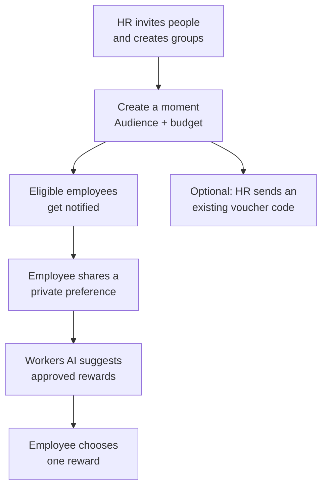
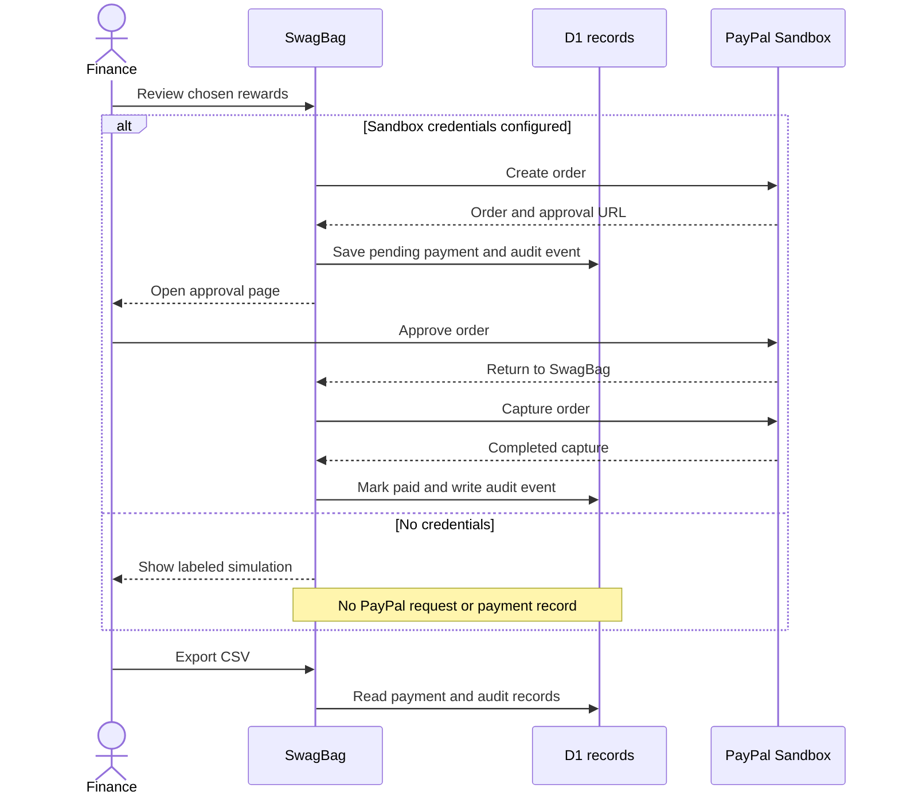

<p align="center">
  
</p>

<h1 align="center">SwagBag</h1>

<p align="center">Give the choice. Keep the joy.</p>

<p align="center">
  <a href="https://swagbag.pages.dev/">Live demo</a> ·
  <a href="https://paypalaihackathon.devpost.com/">PayPal AI Hackathon</a>
</p>


Companies mean well when they give out T-shirts, bottles, and stickers. People often have enough of those already. We built SwagBag so a celebration budget can become something each employee actually wants.

- **HR** creates a moment for everyone, one person, or a selected group, sets the budget, and can share an existing voucher code privately
- **Employees** get notified, ask AI for suggestions from approved rewards, and choose for themselves; their preference stays private
- **Finance** sees commitments, payment records, exports, and an audit trail, with a PayPal sandbox checkout flow for funded moments

<details open>
<summary>How the app works</summary>

**From a moment to a personal choice**

<a href="assets/how-it-works.svg"></a>

**Payment and records**

<a href="assets/payment-and-records.svg"></a>

<details>
<summary>Mermaid source</summary>





</details>

</details>

<details>
<summary>Run locally</summary>

Use Node.js 24 or later, pnpm, and a Cloudflare account for the Workers AI binding.

1. Run `pnpm install` and `pnpm exec wrangler login`.
2. Create a D1 database with `pnpm exec wrangler d1 create swagbag`. Put its name and ID in `wrangler.jsonc` under `d1_databases`.
3. Create an ignored `.dev.vars` file in the project root:

   ```text
   JWT_SECRET=<random string of at least 32 characters>
   COUPON_KEY=<base64-encoded 32-byte random key>
   BOOTSTRAP_SECRET=<random string>
   PAYPAL_CLIENT_ID=<PayPal sandbox client ID>
   PAYPAL_CLIENT_SECRET=<PayPal sandbox client secret>
   ```

   `openssl rand -base64 48` can generate `JWT_SECRET` and `BOOTSTRAP_SECRET`; `openssl rand -base64 32` generates `COUPON_KEY`. Keep these values out of Git.

4. Run `pnpm exec wrangler d1 migrations apply swagbag --local`, `pnpm run build`, and `pnpm exec wrangler pages dev dist --port 8788`.
5. Create the first finance account once with `POST http://localhost:8788/api/bootstrap`. Send JSON fields `name`, `email`, and a password of at least 12 characters, plus an `x-bootstrap-secret` header matching `.dev.vars`. Sign in and invite HR and employee accounts from **People**. Copy and share invitation links manually.

The PayPal sandbox credentials are needed for checkout. For judging, put demo account credentials in Devpost's testing instructions, never in the repository.

</details>

## Built with

| Technology                           | Use in SwagBag                                                                                 |
| ------------------------------------ | ---------------------------------------------------------------------------------------------- |
| PayPal Orders API v2                 | Direct REST integration for sandbox order approval and capture when credentials are configured |
| Cloudflare Workers AI                | Llama 3.2 3B Instruct suggests rewards from the approved catalog                               |
| Cloudflare Pages, Functions, and D1  | Hosting, role-aware API, and application records                                               |
| React, TypeScript, Vite, and ECharts | Responsive interface and finance charts                                                        |
| Codex                                | Assisted with design and development                                                           |

No PayPal open-source SDK or sample project is included; the app calls the official Orders API directly.

SwagBag uses React and Vite rather than Next.js. This kept the client and Cloudflare Functions setup small for the hackathon.

## Hackathon

Built for the <a href="https://paypalaihackathon.devpost.com/">PayPal AI Hackathon</a>. The finance workspace includes a labeled payment-flow simulation for demos without sandbox credentials.

## License

[MIT](LICENSE). SwagBag is an independent PayPal AI Hackathon project. PayPal trademarks remain PayPal's property.
